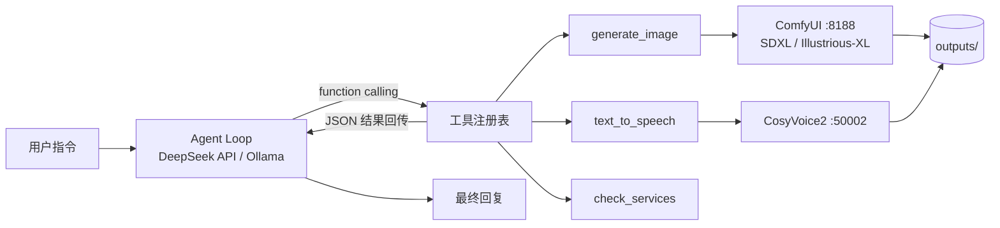

# LLM Agent Workflow · 本地多模态 Agent

> 在 8GB 显存的笔记本上，跑通「一句话指令 → 任务拆解 → 工具调用 → 图像 / 语音生成」的完整链路。


## 项目简介

这是一个个人项目（本地验证，未上线），目标是在 **RTX 5050 Laptop / 8GB 显存** 的普通笔记本上，用尽量低的成本验证本地多模态 Agent 的可行性：

- **模型层**：Ollama 部署 `qwen3:8b`（Q4_K_M 量化），同时支持切换到 DeepSeek API；
- **编排层**：基于 function calling 的 Agent 循环，完成「任务拆解 → 工具执行 → 结果回传 → 输出校验」；
- **工具层**：本地 ComfyUI（SDXL 出图）与 CosyVoice2（语音合成）通过 HTTP 接入；
- **宿主层**：实际部署时通过 DSH（DeepSeek Harness）的本地接口插件接管工具调用，本仓库保留了脱敏后的桥接脚本。

本仓库是这套系统的整理版：去掉个人数据、聊天记录与密钥，保留可复现的编排代码、工具客户端、ComfyUI 工作流和部署笔记。`agent/` 是一个与线上编排等价的最小实现，可以脱离 DSH 独立运行，方便复现和二次开发。

## 实测数据

以下为个人设备实测，仅代表该配置（受驱动版本、上下文长度、散热影响）：

| 项目 | 结果 |
|---|---|
| 设备 | RTX 5050 Laptop，8GB 显存 |
| 模型 | `qwen3:8b`，8.2B 参数，Q4_K_M，磁盘占用 5.2GB |
| 显存占用 | 约 5.6GB，100% 运行在 GPU |
| 生成速度 | 约 20 tok/s |
| 图像生成 | ComfyUI + SDXL 832×1216 |
| 语音合成 | CosyVoice2-0.5B，本地 HTTP 服务 |

> 复现命令：`python integrations/ollama_bench.py --model qwen3:8b`

## 系统架构



核心设计：

- **工具即函数**：每个工具用 JSON Schema 描述参数，注册表统一执行、校验与错误封装。工具抛错时返回结构化 JSON，而不是中断整个循环。
- **循环控制**：`max_steps` 限制工具调用轮数，超时/失败自动降级；达到上限后强制不带工具再请求一次，保证有最终回复。
- **分层提示词**：角色、任务拆解、工具使用、输出校验四层拼接，降低幻觉和任务跑偏。
- **本地优先**：默认走 Ollama 本地模型，配置 `DEEPSEEK_API_KEY` 后可切换到云端 API，接口保持 OpenAI 兼容；在 8GB 卡上跑完整多模态链路时，建议用 DeepSeek API 做编排，把本地显存留给 ComfyUI / CosyVoice。
- **显存调度**：8GB 单卡下出图、TTS、语音克隆不能同时跑，本地 LLM 与出图服务也会抢显存，项目按串行方式组织工具调用。

## 目录结构

```
llm-agent-workflow/
├── agent/                  # Agent 核心
│   ├── loop.py             # 任务拆解 → 工具执行 → 结果回传
│   ├── llm.py              # OpenAI 兼容客户端（DeepSeek / Ollama）
│   ├── tools.py            # 工具注册表与内置工具
│   ├── prompts.py          # 分层提示词
│   ├── memory.py           # 短期记忆
│   └── config.py           # 配置加载
├── integrations/
│   ├── comfyui.py          # ComfyUI HTTP 客户端
│   ├── cosyvoice.py        # CosyVoice2 HTTP 客户端
│   └── ollama_bench.py     # tok/s 与显存实测脚本
├── workflows/
│   └── text2img_sdxl.json  # ComfyUI 工作流（可替换 checkpoint）
├── dsh-bridges/            # DSH 本地接口桥接脚本（脱敏）
├── examples/
│   └── demo.py             # 命令行演示
├── tests/
│   └── test_agent_loop.py  # 不依赖网络的循环测试
├── docs/
│   ├── architecture.md
│   ├── setup.md
│   └── 8gb-vram-notes.md
├── config.example.json
└── requirements.txt
```

## 快速开始

### 1. 克隆与配置

```bash
git clone https://github.com/CLKK522/llm-agent-workflow.git
cd llm-agent-workflow
cp config.example.json config.json
```

核心代码只依赖 Python 标准库（3.9+），不需要额外安装包。

### 2. 启动本地模型

```bash
ollama pull qwen3:8b
ollama run qwen3:8b "你好"
```

确认模型跑在 GPU 上：

```bash
ollama ps
python integrations/ollama_bench.py --model qwen3:8b
```

### 3. 启动多模态服务

ComfyUI 与 CosyVoice2 的安装、模型下载和启动命令见 [docs/setup.md](docs/setup.md)。

### 4. 运行

```bash
python examples/demo.py "画一只在窗边看雨的橘猫，再配一句温柔的晚安语音"
```

Agent 会自行判断需要调用哪些工具，把生成的文件写入 `outputs/`，最后汇总结果。

使用 DeepSeek API：

```bash
# PowerShell
$env:DEEPSEEK_API_KEY="sk-..."
python examples/demo.py --provider deepseek --model deepseek-chat "用一句话介绍你自己"
```

### 5. 测试

```bash
python -m unittest discover -s tests -v
```

## 8GB 显存的实践结论

1. **串行是底线**：出图、TTS、语音克隆同时跑会互相挤显存，轻则回退 CPU，重则 CUDA OOM。工具层按「一次只跑一件」组织。
2. **本地 LLM 与出图二选一**：`qwen3:8b` 常驻约 5.6GB 显存，ComfyUI 再加载 SDXL 时几乎必然 OOM。实际部署用 DeepSeek API 做编排，本地显存留给 ComfyUI / CosyVoice；若必须全本地，调用重工具前先 `ollama stop qwen3:8b`。
3. **量化选型**：`qwen3:8b` 的 Q4_K_M 版本在 8GB 卡上刚好留出上下文和视觉缓冲，是速度与质量的平衡点。
3. **上下文别贪大**：本地 8B 模型在长上下文下显存和速度都会明显恶化，工具结果需要截断后再回传。
4. **服务常驻**：ComfyUI 冷启动约 30–40 秒，CosyVoice2 加载模型约 40 秒；主力工具服务适合常驻，按需启停。

更多踩坑记录见 [docs/8gb-vram-notes.md](docs/8gb-vram-notes.md)。

## 已知限制

- 单人本地项目，未做鉴权、并发与流式输出；
- ComfyUI 工作流依赖指定 checkpoint / upscaler，需按 [docs/setup.md](docs/setup.md) 准备；
- CosyVoice2 的参考音频与音色配置不在仓库中，需自行准备；
- `dsh-bridges/` 依赖 DSH 宿主环境，仅作为接口示例；
- 仓库不包含模型权重、个人数据、聊天记录或任何密钥。

## Roadmap

- [ ] 工具结果缓存与失败重试策略
- [ ] 8GB 显存下的任务队列与自动卸载
- [ ] 更细的输出校验（文件存在性、时长、分辨率）
- [ ] 简单的 Web 调试面板

## License

[MIT](LICENSE) © 2026 孟令常
