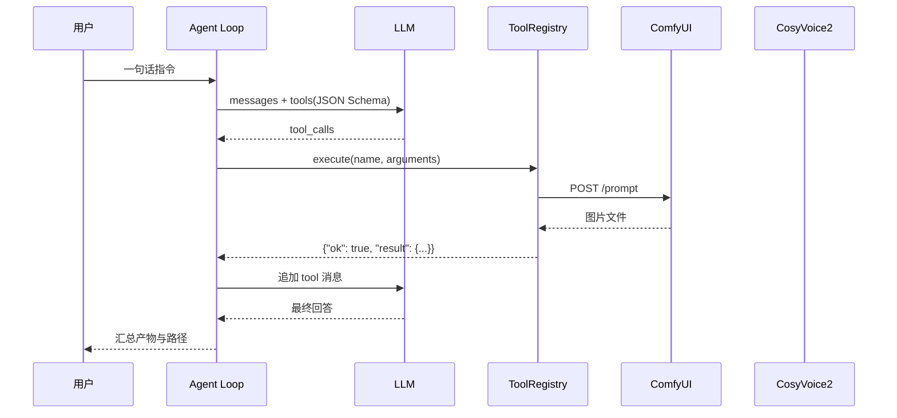

# 架构说明

## 目标与边界

目标：在单张 8GB 显存的消费级显卡上，验证「一句话指令 → 任务拆解 → 多工具调用 → 图像 / 语音产物」的完整链路。

边界：

- 单用户、本机运行，不做鉴权与多租户；
- 工具调用串行执行，不做并行加速；
- 模型与多模态服务都是本地 HTTP 服务，Agent 只负责编排；
- 不做长期记忆的向量检索，只保留最近若干轮对话。

## 组件

| 层 | 组件 | 职责 |
|---|---|---|
| 交互层 | `examples/demo.py` | 命令行入口，加载配置、组装 Agent |
| 编排层 | `agent/loop.py` | function calling 循环、步数控制、结果回传 |
| 模型层 | `agent/llm.py` | OpenAI 兼容接口，支持 Ollama 与 DeepSeek |
| 工具层 | `agent/tools.py` | 工具注册表、JSON Schema、统一错误封装 |
| 工具实现 | `integrations/comfyui.py` | 提交工作流、轮询、下载图片 |
| 工具实现 | `integrations/cosyvoice.py` | 调用本地 TTS、保存 WAV |
| 宿主（实际部署） | `dsh-bridges/*.mjs` | DSH 本地接口桥接脚本 |

## 调用时序



## 消息协议

### 工具定义

每个工具以 OpenAI function calling 的标准格式注册：

```json
{
  "type": "function",
  "function": {
    "name": "generate_image",
    "description": "调用本地 ComfyUI（SDXL）生成图片，返回保存后的文件路径。",
    "parameters": {
      "type": "object",
      "properties": {
        "prompt": {"type": "string"},
        "size": {"type": "string", "default": "832x1216"}
      },
      "required": ["prompt"]
    }
  }
}
```

### 工具结果

工具结果统一为 JSON 字符串，成功与失败都不会抛出到循环外：

```json
{"ok": true, "tool": "generate_image", "result": {"file": "outputs/image_1730000000_123.png"}}
```

```json
{"ok": false, "error": "ComfyUIError: ComfyUI 不可用（http://127.0.0.1:8188）"}
```

这样做的好处：

1. 模型能读懂失败原因，自行决定重试或换方案；
2. 单次工具失败不会中断整个会话；
3. 结果统一截断到 6000 字符，避免长输出挤爆本地模型的上下文。

### 循环控制

```text
for step in 1..max_steps:
    reply = LLM(messages, tools)
    if reply 没有 tool_calls:
        return reply.content
    执行每个 tool_call，把结果作为 role=tool 追加
到达上限后：再请求一次 LLM，但不提供 tools，强制总结
```

## 提示词分层

`agent/prompts.py` 把系统提示词拆成四层，便于单独迭代：

1. **角色**：说明自己是本地 Agent，能力边界由工具决定，不联网；
2. **任务**：先判断是否需要工具，工具结果先看 `ok`，优先少步骤；
3. **工具规范**：尺寸约束、显存约束、不要并行重任务、不要编造结果；
4. **输出校验**：覆盖核心诉求、解释失败、不引用不存在的文件、不重复原始 JSON。

相比把规则塞进一段长提示词，分层后可以单独定位问题：是角色跑偏、任务拆解错误，还是工具使用不当。

## DSH 实际部署

实际运行时，宿主是 DSH（DeepSeek Harness）：

- DSH 负责会话、人设、记忆和插件生命周期；
- `dsh-bridges/tts.mjs`、`image.mjs` 通过 DSH 的「本地接口」接管语音与绘图；
- 桥接脚本把请求转发给本机的 CosyVoice2 与 ComfyUI；
- 失败时抛错，DSH 会回退内置能力或把错误反馈给用户。

本仓库的 `agent/` 是一个不依赖 DSH 的等价最小实现，用于复现和演示编排逻辑。

## 设计取舍

- **为什么不用 LangChain**：链路很短，自己写循环更容易控制超时、错误回传和上下文截断，也避免引入大量依赖。
- **为什么工具结果用 JSON**：模型对结构化字段（`ok` / `error` / `file`）的判断比自然语言更稳定。
- **为什么串行执行**：8GB 显存下并行只会互相抢显存，串行是当前硬件下的正确选择。
- **为什么保留 DSH 桥接脚本**：它是实际部署形态的证据，也能说明本地接口的接入方式。
